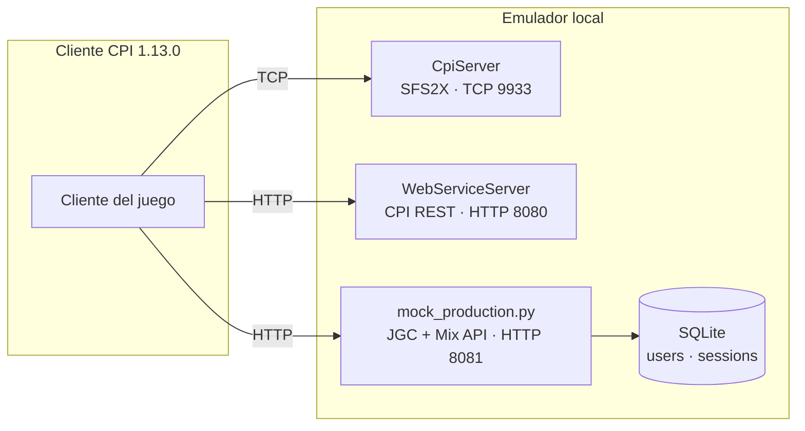

<div align="center">

# Club Penguin Island — Emulador de servidor

Una reimplementación desde cero de los servicios de Club Penguin Island 1.13.0: un servidor de juego
compatible con SFS2X, la API REST de CPI que necesita el cliente para iniciar y un backend de autenticación real.

[Descripción general](#descripción-general) · [Arquitectura](#arquitectura) · [Inicio rápido](#inicio-rápido) · [Configuración](#configuración) · [API](#api-http) · [Pruebas](#pruebas) · [Limitaciones](#limitaciones-conocidas)

</div>

---

## Descripción general

Los servidores de Club Penguin Island cerraron en 2018, dejando al cliente 1.13.0 sin poder superar
la pantalla de carga. Este proyecto reconstruye los contratos que espera ese cliente —a nivel de bytes
cuando es necesario— para que el cliente original pueda autenticarse, entrar a un mundo y jugar en una red local.

No se aplican parches al cliente del juego. El emulador utiliza los mismos protocolos que empleaban
los servicios originales:

- **Protocolo de comunicación SFS2X**, implementado desde cero en C# (delimitación de paquetes, valores tipados,
  acciones del sistema, comandos de extensión y cifrado RSA/AES de salas).
- **Servicios web de CPI** para el proceso de entrada, el perfil del jugador, las recompensas, el estado del tutorial y las compras dentro de la aplicación (IAP).
- **Guest Controller (JGC) y Mix API**, con cuentas reales, contraseñas protegidas mediante bcrypt,
  tokens de sesión firmados y claves AES independientes por cliente.

> **Alcance.** Este repositorio contiene únicamente código del servidor. No se distribuyen el cliente
> del juego, los recursos extraídos ni las notas de ingeniería inversa.

## Funcionalidades disponibles

| Área | Estado | Notas |
| --- | --- | --- |
| Registro de cuentas e inicio de sesión | Funcional | Persistencia en SQLite, bcrypt y detección de duplicados |
| Establecimiento de sesiones Mix | Funcional | Intercambio RSA PKCS#1 v1.5 y mensajes AES-256-CBC |
| Entrada a mundos | Funcional | `JoinRoomData` firmado, listado de salas y entrada automática |
| Movimiento y proximidad | Funcional | Retransmisión de posiciones y seguimiento de usuarios conocidos por sala |
| Chat y actividad | Funcional | `chat.msg`, `chat.activity` y retransmisión genérica de extensiones |
| Variables de usuario y atuendos | Funcional | Difusión de `SetUserVariables` |
| Cifrado de salas | Funcional | Clave AES por sala, entregada mediante la clave RSA del cliente |
| Sincronización de tiempo | Funcional | `time.get` y marca de tiempo del servidor |
| Relaciones sociales y notificaciones | Simulado | Respuestas vacías y estables para que el cliente pueda continuar |
| IAP y derechos de acceso | Simulado | Respuestas de sesión locales, sin pagos reales |

## Arquitectura



Los dos servidores se ejecutan como procesos independientes. `CpiServer` es el servidor autoritativo
del juego; el servicio Python administra la identidad y la capa Mix. `WebServiceServer` lee el `swid`
y el nombre visible directamente del token de acceso firmado, manteniendo los datos del jugador
coherentes con la base de datos de cuentas sin depender de acceso compartido a ella entre procesos.

| Componente | Puerto | Tecnologías | Responsabilidad |
| --- | --- | --- | --- |
| `CpiServer` | 9933/tcp | C# · .NET 8 | Protocolo SFS2X, salas, jugadores, chat y cifrado |
| `WebServiceServer` | 8080/http | C# · .NET 8 | Respuestas de entrada, datos del jugador, recompensas y tutorial |
| `mock_production.py` | 8081/http | Python 3.10+ · SQLite | Cuentas JGC, sesiones Mix y estado AES |

## Inicio rápido

### Requisitos previos

- [SDK de .NET 8](https://dotnet.microsoft.com/download/dotnet/8.0)
- Python 3.10 o posterior (probado con 3.14)
- Un cliente de Club Penguin Island 1.13.0 que poseas legalmente (no incluido)

### 1. Compilar e iniciar el servidor del juego

```bash
dotnet build CpiServer/CpiServer.csproj -c Release
dotnet run --project CpiServer -c Release -- 9933 8080
```

Los argumentos son `[sfsPort] [httpPort]`. El puerto HTTP predeterminado es el 80, que requiere
privilegios elevados en Windows; se recomienda especificar `8080` explícitamente.

### 2. Iniciar el backend de autenticación

```bash
cd CpiServer/tools
python -m venv .venv
.venv\Scripts\activate          # Windows
# source .venv/bin/activate     # macOS / Linux
pip install -r requirements.txt
python mock_production.py 8081
```

La base de datos SQLite se crea durante la primera ejecución en `CpiServer/tools/cpi_auth.db`.
Para restablecer todas las cuentas, detén el servicio y realiza una copia de seguridad antes de eliminar
ese archivo y sus archivos auxiliares `-wal` y `-shm`.

Como alternativa sin dependencias externas, `python mock_final.py 8081` ejecuta el mock original
en memoria. No ejecutes ambos servicios en el mismo puerto.

### 3. Configurar el cliente para usar el emulador

| Endpoint del cliente | Valor local |
| --- | --- |
| API web de CPI | `http://127.0.0.1:8080` |
| Guest Controller / Mix API | `http://127.0.0.1:8081` |
| Socket SFS2X | `127.0.0.1:9933` |

Registra una cuenta desde la pantalla de creación de cuentas del cliente. Las cuentas se conservan
tras reiniciar los servicios; en el siguiente inicio puedes utilizar el flujo normal de acceso.

## Configuración

### Argumentos del servidor

| Argumento | Valor predeterminado | Descripción |
| --- | --- | --- |
| `sfsPort` | `9933` | Puerto de escucha SFS2X |
| `httpPort` | `80` | Puerto de escucha de la API REST de CPI |

### Variables de entorno

| Variable | Valor predeterminado | Descripción |
| --- | --- | --- |
| `CPI_DB_PATH` | `CpiServer/tools/cpi_auth.db` | Archivo de la base de datos SQLite |
| `CPI_API_KEY` | `local-api-key-123` | Valor devuelto por el endpoint JGC `api-key` |
| `CPI_BCRYPT_ROUNDS` | `12` | Factor de coste de bcrypt (usa `4` únicamente para pruebas locales rápidas) |
| `CPI_STRICT_STATUS` | `1` | `1` devuelve `409`/`401`; `0` devuelve `400` con errores que el cliente puede interpretar |

## Diseño de autenticación

El backend implementa los formatos exactos de solicitudes y respuestas que interpreta el SDK de Mix,
no una aproximación.

```
1. POST /jgc/v5/client/{id}/validate
   -> comprobación de disponibilidad; siempre VALID, los duplicados se rechazan al registrar

2. POST /jgc/v5/client/{id}/guest/register
   -> 200 con etag, profile, displayName y token
   -> 409 INUSE_VALUE con inputName profile.username o profile.email

3. POST /jgc/v5/client/{id}/guest/login
   -> 200 con un nuevo par de tokens, o 401 AUTHORIZATION_CREDENTIALS

4. PUT /session/user
   -> clave AES-256 cifrada con RSA + SessionId único (requiere el token de acceso)

5. POST /state (application/mix)
   -> solicitud y respuesta AES-256-CBC vinculadas a ese SessionId
```

**Contraseñas.** Se almacenan como hashes bcrypt (coste 12 por defecto) y nunca se escriben en los logs;
las vistas previas de las solicitudes ocultan las credenciales. Los nombres de usuario son únicos sin
distinguir mayúsculas de minúsculas; los correos electrónicos también son únicos cuando se proporcionan.

**Tokens de acceso.** Contienen los datos de identidad y están firmados, lo que permite que ambos procesos
resuelvan la identidad sin compartir una base de datos:

```
v1.<base64url({"s":"<swid>","n":"<username>"})>.<jti>.<HMAC-SHA256>
```

El secreto HMAC se genera una sola vez y se guarda en la tabla `settings`, por lo que los tokens
se conservan tras reiniciar el servicio. La renovación reemplaza el registro de sesión e invalida el token anterior.

**Errores.** Utilizan el formato nativo del cliente y códigos de estado HTTP:

```json
{
  "data": null,
  "error": {
    "keyCategory": "AUTH",
    "errors": [
      {
        "code": "INUSE_VALUE",
        "inputName": "profile.username",
        "developerMessage": "That username is already taken."
      }
    ]
  }
}
```

El SDK trata cualquier respuesta 4xx como un resultado terminal, sin entrar en un bucle de reintentos.
Ten en cuenta que, con `409`, el SDK de Mix descarta el cuerpo del error asociado al campo; configura
`CPI_STRICT_STATUS=0` si prefieres HTTP `400` para que el cliente muestre en pantalla el error
correspondiente al nombre de usuario o correo electrónico.

## API HTTP

### Servicios web de CPI (`CpiServer`, puerto 8080)

| Método | Ruta | Función |
| --- | --- | --- |
| `POST` | `/game/v1/worlds/{world}/language/{lang}/rooms/{room}/players` | `JoinRoomData` firmado |
| `POST` | `/game/v1/igloos/language/{lang}/.../players` | Entrada a un iglú |
| `GET` | `/game/v1/rooms` | Listado de salas |
| `GET` | `/player/v1/` | Perfil del jugador local (swid y nombre obtenidos del token) |
| `GET` | `/player/v1/id/{swid}` | Perfil de otro jugador |
| `GET` | `/reward/v1/preregistration` | Recompensa de prerregistro |
| `POST` | `/reward/v1/claimServerAdded` | Recompensas añadidas por el servidor (`claimedRewards: []`) |
| `POST` | `/iap-pc/v1/session` | Sesión IAP local |
| `POST` | `/tutorial/v1/tutorial` | Estado del tutorial |

### Identidad y Mix (`mock_production.py`, puerto 8081)

| Método | Ruta | Función |
| --- | --- | --- |
| `GET` | `/jgc/v5/client/{id}/api-key` | Clave API del cliente |
| `POST` | `/jgc/v5/client/{id}/guest/register` | Crear una cuenta |
| `POST` | `/jgc/v5/client/{id}/guest/login` | Autenticarse |
| `POST` | `/jgc/v5/client/{id}/guest/refresh-auth/{token}` | Renovar los tokens |
| `GET`/`POST` | `/jgc/v5/client/{id}/guest/{swid}` | Consultar o actualizar el perfil |
| `GET` | `/jgc/v5/client/{id}/configuration/site` | Configuración de cumplimiento normativo para el registro |
| `PUT` | `/session/user` | Establecimiento de sesión Mix e intercambio de claves AES |
| `POST` | `/state` | Estado Mix cifrado |
| `GET` | `/__health` | Contadores de usuarios, sesiones y sesiones Mix |

## Cobertura del protocolo SFS2X

El servidor C# implementa el subconjunto de SmartFoxServer 2X que utiliza el cliente 1.13.0:

- Delimitación de paquetes TCP con longitudes de 16 bits, cabeceras de paquetes comprimidos y valores tipados.
- Negociación inicial con umbrales de compresión suficientemente altos para desactivarla y límites de tamaño.
- Inicio de sesión con el `SignedResponse<JoinRoomData>` completo incluido dentro de `joinRoomData`.
- Acciones del sistema para listar salas, entrar, salir, ping/pong y cerrar sesión.
- `SetUserVariables`, `SetUserPosition` y distribución de eventos de proximidad a usuarios conocidos.
- Llamadas de extensión: `time.get`, `encryption.get`, `zone.logout` y retransmisión de `l.a`, `chat.msg`,
  `chat.activity`, `chat.activity_cancel` y `proto`.
- Entrega de una clave AES-256 por sala mediante RSA PKCS#1 v1.5.

El servicio Python reproduce la otra parte de la criptografía del cliente: RSA con relleno PKCS#1 v1.5
y AES-256-CBC con un IV de 16 bytes como prefijo y relleno PKCS#7, implementados sin dependencias nativas.

## Fiabilidad y concurrencia

Ambos servidores HTTP están diseñados para manejar el comportamiento real del cliente, no solo peticiones con curl:

- HTTP/1.1 con `Connection: close`, decodificación de solicitudes fragmentadas y sin desincronización
  por conexiones persistentes al manejar cuerpos binarios `application/mix`.
- Los fallos de autenticación devuelven respuestas 4xx estructuradas para que el cliente termine
  el intento en lugar de reintentarlo.
- `ThreadingHTTPServer` asigna un hilo independiente a cada conexión.
- SQLite utiliza el modo WAL, una conexión por solicitud y `BEGIN IMMEDIATE` para las escrituras,
  de modo que los registros concurrentes se serializan correctamente y las lecturas pueden continuar.
- Las claves AES se almacenan por `SessionId` en un registro protegido por un bloqueo. No existe una
  «última clave» global, por lo que dos clientes no pueden descifrar ni sobrescribir el estado del otro.

## Pruebas

La batería de pruebas ejercita los protocolos de forma independiente del cliente del juego.

```bash
# Protocolo SFS2X de extremo a extremo (inicia su propia instancia del servidor)
dotnet build CpiServer -c Release
python CpiServer/tools/smoke_test.py 9933

# Respuesta HTTP de entrada -> inicio de sesión SFS, igual que en el cliente
python CpiServer/tools/web_join_test.py 9933 8080

# Ejecutar la SmartFox2X.dll original de CPI contra el emulador
dotnet run --project CpiServer/tools/client_compat -c Release -- 9933
```

`client_compat` referencia la `SmartFox2X.dll` del cliente; especifica otra ruta si tu cliente
se encuentra en una ubicación diferente:

```bash
dotnet run --project CpiServer/tools/client_compat -c Release \
  -p:SfsDll=/path/to/SmartFox2X.dll -- 9933
```

## Estructura del repositorio

```
CpiServer/
  Game/          Estado de salas, jugadores y variables de usuario
  Net/           Servidor SFS2X, conexión del cliente y servicios web HTTP
  Protocol/      Delimitación de paquetes y serialización de valores SFS
  Program.cs     Punto de entrada del proceso (SFS + HTTP)
  tools/
    mock_production.py   Backend de autenticación con SQLite + bcrypt
    mock_final.py        Mock JGC/Mix en memoria, sin dependencias externas
    smoke_test.py        Prueba independiente del protocolo SFS2X
    web_join_test.py     Prueba de entrada HTTP -> inicio de sesión SFS
    client_compat/       Banco de pruebas con la SmartFox2X.dll original
EMULADOR-CPI-FEATURES.md   Notas sobre protocolos e implementación
INFORME-CPI-REVERSING.md   Notas de ingeniería inversa del cliente
```

## Limitaciones conocidas

- El mundo SFS se mantiene en memoria: el estado de las salas y los jugadores se restablece al reiniciar `CpiServer`.
- Las funciones sociales (amistades, invitaciones y notificaciones) devuelven respuestas vacías y estables.
- IAP es una simulación local; no se procesan compras.
- SQLite y el registro de sesiones están diseñados para un solo nodo; este es un emulador a escala de red local.
- Los servicios utilizan HTTP sin cifrado. Si los expones fuera de localhost, coloca un proxy con
  terminación TLS delante y reemplaza la clave API predeterminada.

## Aviso legal

Este es un proyecto educativo de preservación. No está afiliado a Disney ni cuenta con su respaldo
o apoyo. Club Penguin Island y las marcas relacionadas son propiedad de sus respectivos titulares.
No se distribuyen aquí recursos del juego, binarios del cliente ni código propietario. Utiliza el
emulador únicamente con un cliente y recursos que tengas derecho a usar legalmente.
