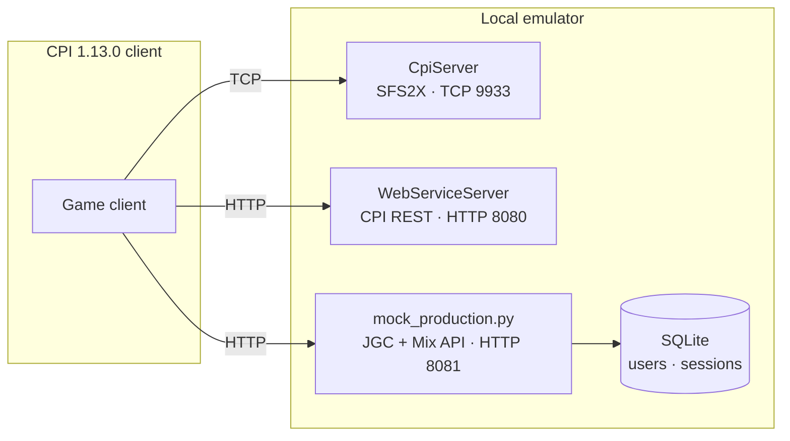

<div align="center">

# Club Penguin Island — Server Emulator

A clean-room reimplementation of the Club Penguin Island 1.13.0 server stack: an SFS2X-compatible
game server, the CPI REST surface the client needs to boot, and a real authentication backend.

[Overview](#overview) · [Architecture](#architecture) · [Quick start](#quick-start) · [Configuration](#configuration) · [API](#http-api) · [Testing](#testing) · [Limitations](#known-limitations)

</div>

---

## Overview

Club Penguin Island's servers went offline in 2018, leaving the 1.13.0 client unable to get past its
loading screen. This project rebuilds the contracts that client expects — at the byte level where
necessary — so the original client can authenticate, join a world, and play on a local network.

Nothing in the game client is patched. The emulator speaks the same protocols the production
services did:

- **SFS2X wire protocol** implemented from scratch in C# (framing, typed values, system actions,
  extension commands, RSA/AES room encryption).
- **CPI web services** for the join handshake, player profile, rewards, tutorial state, and IAP.
- **Guest Controller (JGC) and Mix API** with real accounts, bcrypt password hashing, signed
  session tokens, and per-client AES keys.

> **Scope.** This repository contains server code only. The game client, extracted assets, and
> reverse-engineering notes are not distributed.

## What works

| Area | Status | Notes |
| --- | --- | --- |
| Account registration and login | Working | SQLite persistence, bcrypt, duplicate detection |
| Mix session establishment | Working | RSA PKCS#1 v1.5 handshake, AES-256-CBC payloads |
| World join | Working | Signed `JoinRoomData`, room list, auto-join |
| Movement and proximity | Working | Position relay, known-user tracking per room |
| Chat and activity | Working | `chat.msg`, `chat.activity`, generic extension relay |
| User variables and outfits | Working | `SetUserVariables` broadcast |
| Room encryption | Working | Per-room AES key delivered with the client RSA key |
| Time synchronization | Working | `time.get` / server timestamp |
| Social graph, notifications | Stubbed | Empty, stable payloads so the client proceeds |
| IAP and entitlements | Stubbed | Local session responses, no real payments |

## Architecture



The two servers are independent processes. `CpiServer` is the authoritative game server; the Python
service owns identity and the Mix layer. `WebServiceServer` reads the `swid` and display name
directly from the signed access token, so player data stays consistent with the account database
without a cross-process database dependency.

| Component | Port | Stack | Responsibility |
| --- | --- | --- | --- |
| `CpiServer` | 9933/tcp | C# · .NET 8 | SFS2X protocol, rooms, players, chat, encryption |
| `WebServiceServer` | 8080/http | C# · .NET 8 | Join responses, player data, rewards, tutorial |
| `mock_production.py` | 8081/http | Python 3.10+ · SQLite | JGC accounts, Mix sessions, AES state |

## Quick start

### Prerequisites

- [.NET 8 SDK](https://dotnet.microsoft.com/download/dotnet/8.0)
- Python 3.10 or newer (tested on 3.14)
- A Club Penguin Island 1.13.0 client you lawfully own (not included)

### 1. Build and start the game server

```bash
dotnet build CpiServer/CpiServer.csproj -c Release
dotnet run --project CpiServer -c Release -- 9933 8080
```

The arguments are `[sfsPort] [httpPort]`. The HTTP default is port 80, which requires elevated
privileges on Windows; passing `8080` explicitly is recommended.

### 2. Start the authentication backend

```bash
cd CpiServer/tools
python -m venv .venv
.venv\Scripts\activate          # Windows
# source .venv/bin/activate     # macOS / Linux
pip install -r requirements.txt
python mock_production.py 8081
```

The SQLite database is created on first run at `CpiServer/tools/cpi_auth.db`. Delete the file
(and its `-wal` / `-shm` companions) to reset all accounts.

For a zero-dependency fallback, `python mock_final.py 8081` runs the original in-memory mock. Do
not run both on the same port.

### 3. Point the client at the emulator

| Client endpoint | Local value |
| --- | --- |
| CPI web API | `http://127.0.0.1:8080` |
| Guest Controller / Mix API | `http://127.0.0.1:8081` |
| SFS2X socket | `127.0.0.1:9933` |

Register an account on the client's create-account screen. Accounts persist across restarts;
the next launch goes through the normal login flow.

## Configuration

### Server CLI

| Argument | Default | Description |
| --- | --- | --- |
| `sfsPort` | `9933` | SFS2X listener |
| `httpPort` | `80` | CPI REST listener |

### Environment variables

| Variable | Default | Description |
| --- | --- | --- |
| `CPI_DB_PATH` | `CpiServer/tools/cpi_auth.db` | SQLite database file |
| `CPI_API_KEY` | `local-api-key-123` | Value returned by the JGC `api-key` endpoint |
| `CPI_BCRYPT_ROUNDS` | `12` | bcrypt cost factor (use `4` for fast local tests only) |
| `CPI_STRICT_STATUS` | `1` | `1` returns `409`/`401`; `0` returns `400` with client-mappable errors |

## Authentication design

The backend implements the exact request/response shapes the Mix SDK parses, not an approximation.

```
1. POST /jgc/v5/client/{id}/validate
   -> availability probe; always VALID, duplicates are rejected at registration

2. POST /jgc/v5/client/{id}/guest/register
   -> 200 with etag, profile, displayName, token
   -> 409 INUSE_VALUE with inputName profile.username or profile.email

3. POST /jgc/v5/client/{id}/guest/login
   -> 200 with a fresh token pair, or 401 AUTHORIZATION_CREDENTIALS

4. PUT /session/user
   -> RSA-encrypted AES-256 key + unique SessionId (requires the access token)

5. POST /state (application/mix)
   -> AES-256-CBC request/response bound to that SessionId
```

**Passwords** are hashed with bcrypt (cost 12 by default) and never logged; request previews redact
credentials. Usernames are unique case-insensitively; emails are unique when present.

**Access tokens** are self-describing but signed, so both processes can resolve identity without a
shared database:

```
v1.<base64url({"s":"<swid>","n":"<username>"})>.<jti>.<HMAC-SHA256>
```

The HMAC secret is generated once and persisted in the `settings` table, so tokens survive restarts.
Refresh rotates the session row and invalidates the previous token.

**Errors** use the client's native envelope, with HTTP status codes:

```json
{
  "data": null,
  "error": {
    "keyCategory": "AUTH",
    "errors": [
      {
        "code": "INUSE_VALUE",
        "inputName": "profile.username",
        "developerMessage": "That username is already taken."
      }
    ]
  }
}
```

The SDK treats any 4xx as a terminal result — never a retry loop. Note that on `409` the Mix SDK
discards the field-level error body; set `CPI_STRICT_STATUS=0` if you prefer HTTP `400` so the
client surfaces the mapped username/email error on screen.

## HTTP API

### CPI web services (`CpiServer`, port 8080)

| Method | Route | Purpose |
| --- | --- | --- |
| `POST` | `/game/v1/worlds/{world}/language/{lang}/rooms/{room}/players` | Signed `JoinRoomData` |
| `POST` | `/game/v1/igloos/language/{lang}/.../players` | Igloo join |
| `GET` | `/game/v1/rooms` | Room list |
| `GET` | `/player/v1/` | Local player profile (swid and name from token) |
| `GET` | `/player/v1/id/{swid}` | Other player profile |
| `GET` | `/reward/v1/preregistration` | Preregistration reward |
| `POST` | `/reward/v1/claimServerAdded` | Server-added rewards (`claimedRewards: []`) |
| `POST` | `/iap-pc/v1/session` | Local IAP session |
| `POST` | `/tutorial/v1/tutorial` | Tutorial state |

### Identity and Mix (`mock_production.py`, port 8081)

| Method | Route | Purpose |
| --- | --- | --- |
| `GET` | `/jgc/v5/client/{id}/api-key` | Client API key |
| `POST` | `/jgc/v5/client/{id}/guest/register` | Create account |
| `POST` | `/jgc/v5/client/{id}/guest/login` | Authenticate |
| `POST` | `/jgc/v5/client/{id}/guest/refresh-auth/{token}` | Rotate tokens |
| `GET`/`POST` | `/jgc/v5/client/{id}/guest/{swid}` | Read/update profile |
| `GET` | `/jgc/v5/client/{id}/configuration/site` | Registration compliance config |
| `PUT` | `/session/user` | Mix handshake and AES key exchange |
| `POST` | `/state` | Encrypted Mix state |
| `GET` | `/__health` | Counters for users, sessions, Mix sessions |

## SFS2X protocol coverage

The C# server implements the subset of SmartFoxServer 2X that the 1.13.0 client exercises:

- TCP framing with 16-bit lengths, compressed-packet headers, and typed values.
- Handshake with compression thresholds high enough to disable compression and size limits.
- Login with the full `SignedResponse<JoinRoomData>` carried inside `joinRoomData`.
- Room list, join, leave, ping/pong, and logout system actions.
- `SetUserVariables`, `SetUserPosition`, and proximity fan-out for known users.
- Extension calls: `time.get`, `encryption.get`, `zone.logout`, and relay for `l.a`, `chat.msg`,
  `chat.activity`, `chat.activity_cancel`, and `proto`.
- RSA PKCS#1 v1.5 delivery of a per-room AES-256 key.

The Python side mirrors the other half of the client's crypto: RSA with PKCS#1 v1.5 padding and
AES-256-CBC with a 16-byte IV prefix and PKCS#7 padding, implemented without native dependencies.

## Reliability and concurrency

Both HTTP servers are designed to survive real client behavior rather than just curl:

- HTTP/1.1 with `Connection: close`, chunked request decoding, and no keep-alive desync on binary
  `application/mix` bodies.
- Authentication failures return structured 4xx responses, so the client fails once instead of
  retrying.
- `ThreadingHTTPServer` gives each connection its own thread.
- SQLite runs in WAL mode with one connection per request and `BEGIN IMMEDIATE` for writes, so
  concurrent registrations serialize cleanly and readers never block.
- AES keys are stored per `SessionId` in a locked registry. There is no global "latest key", so two
  clients cannot decrypt or overwrite each other's state.

## Testing

The test suite drives the protocols independently of the game client.

```bash
# SFS2X wire protocol end to end (starts its own server instance)
dotnet build CpiServer -c Release
python CpiServer/tools/smoke_test.py 9933

# HTTP join response -> SFS login, exactly like the client
python CpiServer/tools/web_join_test.py 9933 8080

# Run the real SmartFox2X.dll shipped with CPI against the emulator
dotnet run --project CpiServer/tools/client_compat -c Release -- 9933
```

`client_compat` references the client's `SmartFox2X.dll`; override the path if your client lives
elsewhere:

```bash
dotnet run --project CpiServer/tools/client_compat -c Release \
  -p:SfsDll=/path/to/SmartFox2X.dll -- 9933
```

## Repository layout

```
CpiServer/
  Game/          Room, player, and user-variable state
  Net/           SFS2X server, client connection, HTTP web services
  Protocol/      Packet framing and SFS value serialization
  Program.cs     Process entry point (SFS + HTTP)
  tools/
    mock_production.py   SQLite + bcrypt authentication backend
    mock_final.py        Dependency-free in-memory JGC/Mix mock
    smoke_test.py        Independent SFS2X protocol test
    web_join_test.py     HTTP join -> SFS login test
    client_compat/       Real SmartFox2X.dll compatibility harness
EMULADOR-CPI-FEATURES.md   Protocol and implementation notes
INFORME-CPI-REVERSING.md   Client reverse-engineering notes
```

## Known limitations

- The SFS world is in-memory: room and player state reset when `CpiServer` restarts.
- Social features (friends, invitations, notifications) return stable empty payloads.
- IAP is a local stub; no purchases are processed.
- SQLite and the session registry are single-node by design; this is a LAN-scale emulator.
- The services are plain HTTP. If you expose them beyond localhost, terminate TLS in front and
  replace the default API key.

## Legal

This is an educational preservation project. It is not affiliated with, endorsed by, or supported
by Disney. Club Penguin Island and related marks are the property of their respective owners. No
game assets, client binaries, or proprietary code are distributed here. Use the emulator only with
a client and assets you are legally entitled to use.
